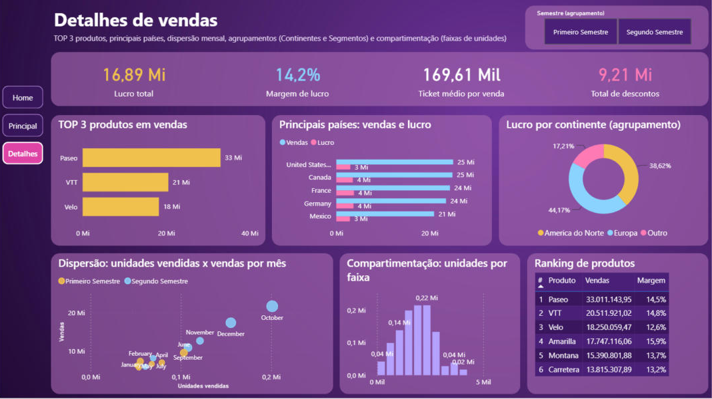
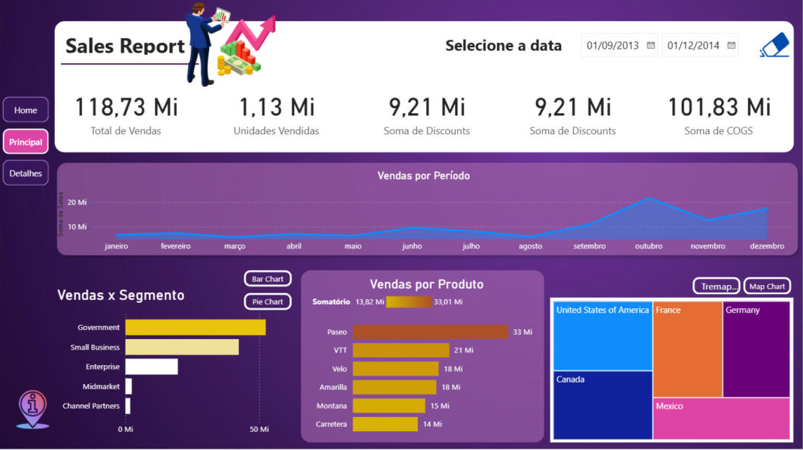
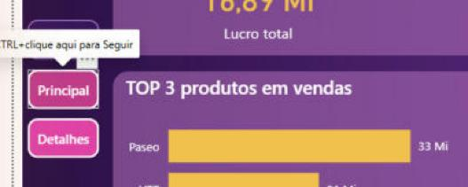

# Desafio de Projeto DIO — Sales Report: Data Analytics e Experiência do Usuário no Power BI

Desafio da formação **Power BI Analyst** da [DIO](https://www.dio.me/). A página do desafio combina duas frentes sobre o mesmo relatório `Sales Report` (Financial Sample):

1. **Data Analytics** — criar a página **Detalhes** com os visuais de análise: TOP 3 produtos, principais países em vendas e lucro, dispersão de unidades vendidas × vendas por mês, agrupamentos e compartimentação de dados, com as medidas DAX necessárias.
2. **Experiência do usuário** — menus de navegação em todas as páginas, botões com os estados **padrão / focalizar / pressionar** destacados, três páginas, e atenção a posicionamento, contraste, proporção e segmentação dos dados.

## Arquivos

| Pasta / arquivo | Conteúdo |
|---|---|
| `sales_report_data_analytics.pbix` | Relatório final com as três páginas (Home, Principal e Detalhes), menus de navegação e medidas |
| `prints/` | As três páginas e o menu no estado *focalizar* |
| `power-query/medidas.dax` | Todas as medidas do modelo (as 7 do curso + as 8 criadas neste desafio) |
| `pbip/` | O modelo semântico em TMDL (`financials.tmdl` com medidas, grupos, bins e clusters) e o projeto completo em `sales_report_pbip.zip` (formato Power BI Project: TMDL + PBIR) |
| `scripts/gerar_pagina_detalhes.py` | Script que gera a página Detalhes e os menus a partir do projeto PBIP (documenta exatamente o que foi adicionado) |
| `enunciado/` | Texto do enunciado |

Os arquivos de partida (`sales_report_desafio_projeto.pbix` e `exemplo.pbix`) estão no repositório do curso: [julianazanelatto/power_bi_analyst — Módulo 5](https://github.com/julianazanelatto/power_bi_analyst/tree/main/M%C3%B3dulo%205).

## O relatório

### Home

Capa do relatório, mantida do arquivo original, com o botão **Explorar análise** (vai para a página Principal) e um menu com acesso direto às páginas **Principal** e **Detalhes**.

### Principal

Página construída nas aulas (cartões, vendas por período, vendas × segmento com alternância barra/pizza por indicadores, vendas por produto e vendas por país com alternância treemap/mapa). A seta "Next", que apontava para uma página que não existia, foi substituída pelo **menu lateral** com os três destinos; o botão da página atual aparece destacado.

### Detalhes (nova)

A página responde aos pontos pedidos no desafio, lendo de cima para baixo e da esquerda para a direita, como o cliente consome o conteúdo: filtro e indicadores no topo, análises principais no meio, detalhamento embaixo.

| Visual | O que mostra | Pede do enunciado |
|---|---|---|
| Segmentador **Semestre** (tiles horizontais) | Filtra a página pelo grupo `Semestres` | Segmentação dos dados |
| Cartões | Lucro total, margem de lucro, ticket médio por venda e total de descontos | Medidas |
| **TOP 3 produtos em vendas** | Barras com a medida `TOP3 PRODUCT` (só os três maiores aparecem) | TOP 3 produtos |
| **Principais países: vendas e lucro** | Barras agrupadas por país com `total sales` e `Total Profit` | Principais países |
| **Lucro por continente** | Rosca pelo grupo `Continentes` (América do Norte, Europa, Outro) | Agrupamento |
| **Dispersão: unidades × vendas por mês** | Gráfico de dispersão com um ponto por mês (`Month Name`), X = unidades vendidas, Y = vendas, tamanho = lucro, legenda pelo grupo `Semestres` | Dispersão + agrupamento |
| **Compartimentação: unidades por faixa** | Colunas pela coluna de bins `Buckets` (Units Sold em 10 faixas) | Compartimentação |
| **Ranking de produtos** | Tabela com `Ranking Produto` (RANKX), vendas e margem | Medidas |

## Medidas DAX criadas

As medidas foram adicionadas à tabela `financials`, ao lado das que já existiam no arquivo do curso (`total sales`, `total de vendidos`, `TOP3 PRODUCT`, `avg sales`, `Máximo sold`, `outlier`, `Meta`).

| Medida | Expressão |
|---|---|
| Total Profit | `SUM(financials[Profit])` |
| Total Discounts | `SUM(financials[Discounts])` |
| Margem de Lucro | `DIVIDE([Total Profit], [total sales])` |
| Ticket Médio | `DIVIDE([total sales], COUNTROWS(financials))` |
| Qtd Países | `DISTINCTCOUNT(financials[Country])` |
| Ranking Produto | `RANKX(ALL(financials[Product]), [total sales])` |
| Vendas TOP3 (%) | `DIVIDE(CALCULATE([total sales], TOPN(3, ALL(financials[Product]), [total sales])), CALCULATE([total sales], ALL(financials[Product])))` |
| Unidades Médias por Mês | `AVERAGEX(VALUES(financials[Month Name]), [total de vendidos])` |

A medida do curso usada no TOP 3 é `TOP3 PRODUCT = CALCULATE([total sales], TOPN(3, ALL(financials[Product]), [total sales]), VALUES(financials[Product]))`: ela devolve vendas só para os três produtos de maior venda e em branco para os demais, por isso o gráfico de barras exibe apenas Paseo, VTT e Velo.

## Agrupamentos e compartimentação

O modelo traz os recursos de **Data Analytics** vistos no módulo, usados na página Detalhes:

- **Grupos** (`Novo grupo` sobre colunas de texto): `Continentes` (Country → América do Norte / Europa / Outro), `Segmentos agrupados` (Segment → Destaque / Outro) e `Semestres` (Month Name → Primeiro / Segundo Semestre).
- **Bins** (`Novo grupo` sobre coluna numérica, tipo compartimento): `Buckets`, que divide `Units Sold` em 10 faixas de tamanho igual.
- **Clusters**: `Profit (clusters)`, gerado pela análise de clusters do Power BI sobre o lucro (tabela auxiliar `ClusterMappingTable`).

Em TMDL essas colunas aparecem em `pbip/sales_report.SemanticModel/definition/tables/financials.tmdl` com a anotação `GroupingDesignState`, que é como o Power BI guarda a definição de um grupo ou bin.

## Navegação e experiência do usuário

- **Menu em todas as páginas.** Na Home, dois botões sob o "Explorar análise"; nas páginas Principal e Detalhes, um menu lateral fixo (Home / Principal / Detalhes) na faixa esquerda, fora da área dos visuais.
- **Estados dos botões.** Cada botão tem três estilos: *padrão* (roxo escuro translúcido, borda lilás), *focalizar* (ao passar o mouse: preenchimento magenta, borda branca, texto em negrito) e *pressionar* (rosa claro com texto escuro). O botão da página em que o usuário está já aparece destacado em magenta, funcionando como "selecionado".
- **Posicionamento e proporção.** O menu ocupa a coluna de 90 px à esquerda que o layout original deixava livre; a página Detalhes usa a mesma grade do relatório original (cartões em faixa, três colunas de visuais) e os mesmos cartões arredondados roxos (`ColorId 5`, 36 % de transparência) para manter a identidade visual.
- **Contraste.** Textos, eixos e legendas em branco sobre o fundo roxo; dados em amarelo (`#F2C14E`), azul claro (`#8BD3FF`), rosa (`#FF7AB6`) e lilás (`#B5A1FF`), as mesmas famílias de cor da página Principal.
- **Segmentação.** Segmentador de semestre na página Detalhes (além do intervalo de datas da Principal), e todos os visuais da página interagem entre si.

## Como foi construído

1. O `sales_report_desafio_projeto.pbix` foi salvo como **projeto do Power BI (.pbip)**, o que expõe o modelo em TMDL e o relatório em PBIR (arquivos de texto).
2. As medidas foram escritas em `financials.tmdl`; a página Detalhes, os visuais e os botões com estados foram definidos em JSON (`scripts/gerar_pagina_detalhes.py`).
3. O projeto foi reaberto no Power BI Desktop, conferido (navegação, estados dos botões, filtros) e salvo como `sales_report_data_analytics.pbix`.

## Como abrir

Baixe `sales_report_data_analytics.pbix` e abra no Power BI Desktop. Para navegar pelos botões dentro do Desktop use **Ctrl + clique**; no Power BI Service basta clicar.
